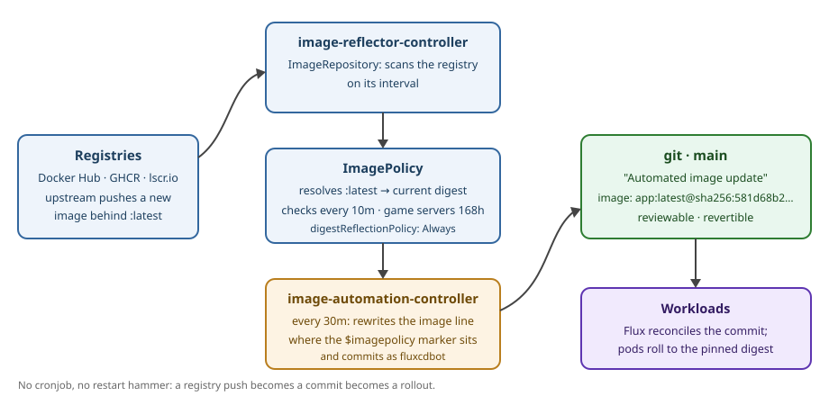

Most of my homelab runs images tagged `:latest`, which is less a versioning strategy than a hope. For a long time, "updating" those containers meant a CronJob whose entire job was to restart things. It worked, in the sense that a hammer works. This is the story of replacing it with Flux Image Automation — where the cluster watches the registries itself, and every image update arrives as a small, boring, revertible git commit. Which is what updates should be.

## Before: `:latest` and a monthly restart hammer

The old setup had two ingredients. Every deployment used a `:latest` image with an always-pull policy, and once a month — `0 0 1 * *`, midnight on the 1st — a CronJob ran a script that found **every** deployment in **every** namespace using a `:latest` image and `kubectl rollout restart`ed it, one at a time, with a two-minute nap between victims to soften the blast radius:

```yaml
apiVersion: batch/v1
kind: CronJob
metadata:
  name: rollout-latest
spec:
  schedule: "0 0 1 * *"
  jobTemplate:
    spec:
      template:
        spec:
          containers:
            - name: kubectl
              image: bitnami/kubectl:latest
              command: [/bin/bash, -ceu, |
                # for each deployment in the cluster:
                #   if any container image ends in :latest
                #     kubectl rollout restart it, then sleep 120
              ]
```

The restart forced a fresh pull, the fresh pull got whatever `:latest` meant that night, and the pod came back updated. Simple. Also, on reflection, bad in three specific ways:

- **Indiscriminate.** Everything restarted whether its image had changed or not — download stack, homepage, and game servers alike. A Minecraft server does not care that it's 12:01 AM on the 1st; its players do.
- **No record.** Nothing in git changed, ever. "What version is the torrent client running?" had no answer beyond "whatever `latest` was on the 1st." No diff, no audit trail, nothing to revert if an update was bad — just restart again and hope `latest` had moved on.
- **It fought GitOps.** A rollout restart works by stamping an annotation on the pod template. To Flux, that annotation is *drift* — something changed outside git — and Flux's job is to reconcile drift away. Mostly that just silently undid restarts. Once, it wedged a ClickHouse rollout entirely: the reconciled-away annotation left a RollingUpdate stuck mid-flight. My update mechanism and my deployment mechanism were in a turf war.

## Now: the registry is watched, the update is a commit

Flux ships two extra controllers for exactly this — an image reflector and an image automation controller — and the whole pattern is three small objects per image. An `ImageRepository` says "watch this image, on this interval." An `ImagePolicy` says which tag (or digest) currently wins:

```yaml
apiVersion: image.toolkit.fluxcd.io/v1
kind: ImagePolicy
metadata:
  name: qbittorrent
  namespace: flux-system
spec:
  imageRepositoryRef:
    name: qbittorrent
  filterTags:
    pattern: "^latest$"
  policy:
    alphabetical: { order: asc }
  digestReflectionPolicy: Always   # track the digest behind the mutable tag
  interval: 10m                     # re-check that digest every 10 minutes
```

`latest` is a mutable tag — the name stays, the image behind it changes — so the important line is `digestReflectionPolicy: Always`. The policy doesn't just resolve the tag; it keeps the tag's current **digest** fresh. Then, in each deployment manifest, the image line carries a marker comment:

```yaml
image: ghcr.io/advplyr/audiobookshelf:latest # {"$imagepolicy": "flux-system:audiobookshelf"}
```

…and every 30 minutes the `ImageUpdateAutomation` walks the repo, and where a policy's digest has moved, it rewrites the line in git and commits as itself:

```yaml
image: ghcr.io/advplyr/audiobookshelf:latest@sha256:581d68b2… # {"$imagepolicy": "flux-system:audiobookshelf"}
```

```
commit e2b4492
Author: fluxcdbot <fluxcdbot@users.noreply.github.com>

    Automated image update

    Files updated:
    - audiobookshelf/audiobookshelf.yaml
    - cs2/manifest.yaml
    - flux-orchestrator/deploy.yaml
```

That commit is the first one the bot ever made, and I won't pretend it came easy (next section). But look at what it buys. The update is a diff. I can read it, I can see *which* images moved and to *which exact digest*, and if an update is bad, `git revert` puts the old digest back and Flux rolls it out. The version running in the cluster is finally a question git can answer.

## Granularity and windows

This is the part the hammer could never do: **cadence is per image.**

- The download/media stack — qBittorrent, Prowlarr, NZBGet, Audiobookshelf, the homepage, a few others — checks digests every **10 minutes**. These are apps I want current, and a restart is a shrug.
- The game servers (Minecraft, CS2, and their shared rcon sidecar) scan on a **168-hour** interval. An update can only ever surface once a week, so a world never restarts mid-session because a modpack pushed a build on a Tuesday.
- The automation itself commits on a 30-minute cycle, batching whatever moved into one tidy commit.

Eleven images are on this now. And the turf war is over: nothing outside git mutates the pod template anymore, so a manual `kubectl rollout restart` is just a restart — Flux has no drift to "fix," and image changes only ever flow one direction, from a commit.

## The honest part: it took nine PRs

Flux's docs make this look like a three-manifest afternoon, and eventually it was — but the road there, across two days and PRs #58–#69, included: the CRDs having moved to API `v1` while every example said `v1beta2`; `digestReflectionPolicy: Always` being silently rejected because it also requires an `interval` (no error, just… nothing); the controllers getting installed into the wrong namespace with no RBAC, cheerfully logging permission errors; vendoring the controller deployments because the upstream kustomize remote bases wedged Flux's drift detection for hours; and the automation failing to commit because the message template field is `.Changed.FileChanges` — a name I arrived at via two wrong guesses and reading the controller source. The 15:30 "why are there no commits yet" investigation is a genre of homelab debugging unto itself. It's all in the git history, which — see above — is rather the point of doing it this way.



*The end state. A registry push becomes a git commit becomes a rollout — and nothing else touches the cluster.*

The old CronJob is still in the repo, `suspend: true`, as a tombstone. What's left: a few `:latest` stragglers on apps that run at zero replicas anyway, and wiring the automation's commits to a Gotify ping so I hear about them instead of noticing. The lesson, if there is one: **an update you can `git revert` beats an update you have to remember.** Restarts were never an update strategy. They were a recurring earthquake with a cron expression.

*Drafted with Jett's help, as usual; the nine PRs, regrettably, were also real.*
